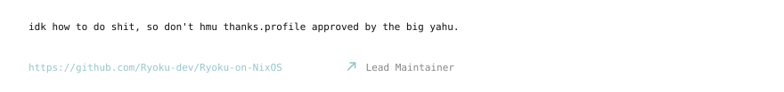
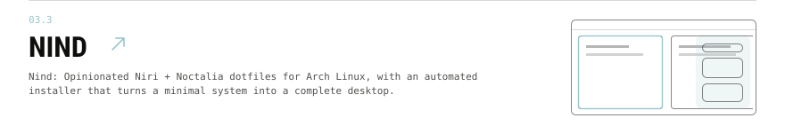
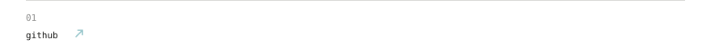

<!-- Generated by profile/build.mjs. Edit the generator, then rebuild. -->

<a href="https://github.com/feelyourwarmth/feelyourwarmth"><picture><source media="(prefers-color-scheme: dark)" srcset="https://raw.githubusercontent.com/feelyourwarmth/feelyourwarmth/main/profile/surface-dark-da6e51ad62a2.svg"></picture></a>

<a href="https://github.com/Ryoku-dev/Ryoku-on-NixOS"><picture><source media="(prefers-color-scheme: dark)" srcset="https://raw.githubusercontent.com/feelyourwarmth/feelyourwarmth/main/profile/intro-dark-733c4d7fd034.svg"></picture></a>

<a href="https://github.com/feelyourwarmth/Ryoku-on-NixOS"><picture><source media="(prefers-color-scheme: dark)" srcset="https://raw.githubusercontent.com/feelyourwarmth/feelyourwarmth/main/profile/layers-dark-c29eb8116f53.svg"></picture></a>

<a href="https://github.com/feelyourwarmth?tab=repositories"><picture><source media="(prefers-color-scheme: dark)" srcset="https://raw.githubusercontent.com/feelyourwarmth/feelyourwarmth/main/profile/work-dark-2f63a798a42d.svg"></picture></a>
<a href="https://github.com/Ryoku-dev/Ryoku-on-NixOS"><picture><source media="(prefers-color-scheme: dark)" srcset="https://raw.githubusercontent.com/feelyourwarmth/feelyourwarmth/main/profile/work-1-dark-cfdd720c2bab.svg"></picture></a>
<a href="https://github.com/Ryoku-dev/ryostore"><picture><source media="(prefers-color-scheme: dark)" srcset="https://raw.githubusercontent.com/feelyourwarmth/feelyourwarmth/main/profile/work-2-dark-83c142c090a2.svg"></picture></a>
<a href="https://github.com/feelyourwarmth/Nind"><picture><source media="(prefers-color-scheme: dark)" srcset="https://raw.githubusercontent.com/feelyourwarmth/feelyourwarmth/main/profile/work-3-dark-30ac79061003.svg"></picture></a>
<a href="https://github.com/feelyourwarmth/NixOS"><picture><source media="(prefers-color-scheme: dark)" srcset="https://raw.githubusercontent.com/feelyourwarmth/feelyourwarmth/main/profile/work-4-dark-c342657c3205.svg"></picture></a>

<a href="https://github.com/feelyourwarmth?tab=repositories"><picture><source media="(prefers-color-scheme: dark)" srcset="https://raw.githubusercontent.com/feelyourwarmth/feelyourwarmth/main/profile/signal-dark-6ebc9181f43b.svg"></picture></a>

<a href="https://github.com/feelyourwarmth/NixOS"><picture><source media="(prefers-color-scheme: dark)" srcset="https://raw.githubusercontent.com/feelyourwarmth/feelyourwarmth/main/profile/shell-dark-6f15f12026ff.svg"></picture></a>

<a href="https://github.com/feelyourwarmth"><picture><source media="(prefers-color-scheme: dark)" srcset="https://raw.githubusercontent.com/feelyourwarmth/feelyourwarmth/main/profile/link-1-dark-c70eb8eede92.svg"></picture></a>
